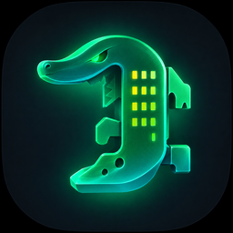
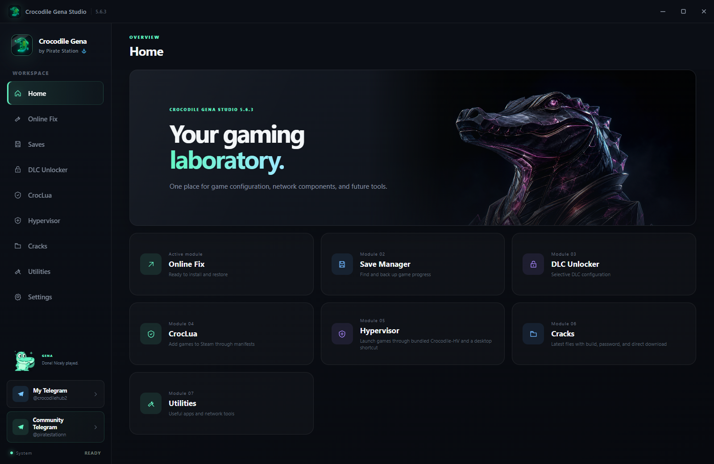
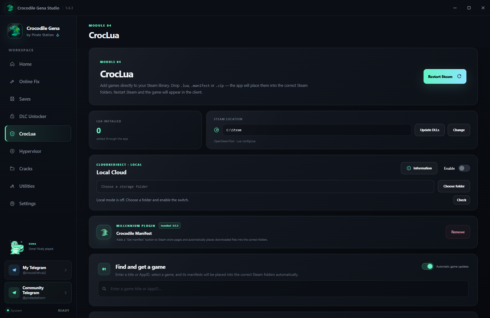
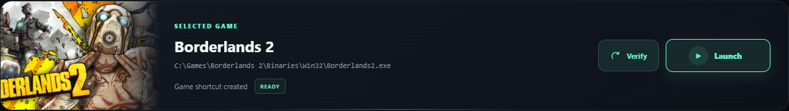
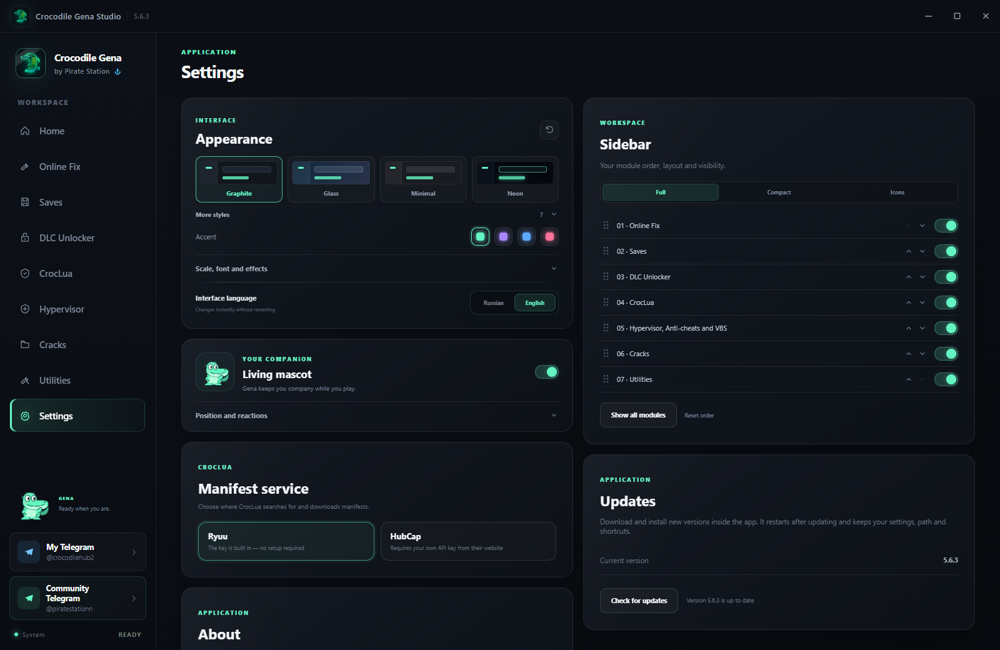
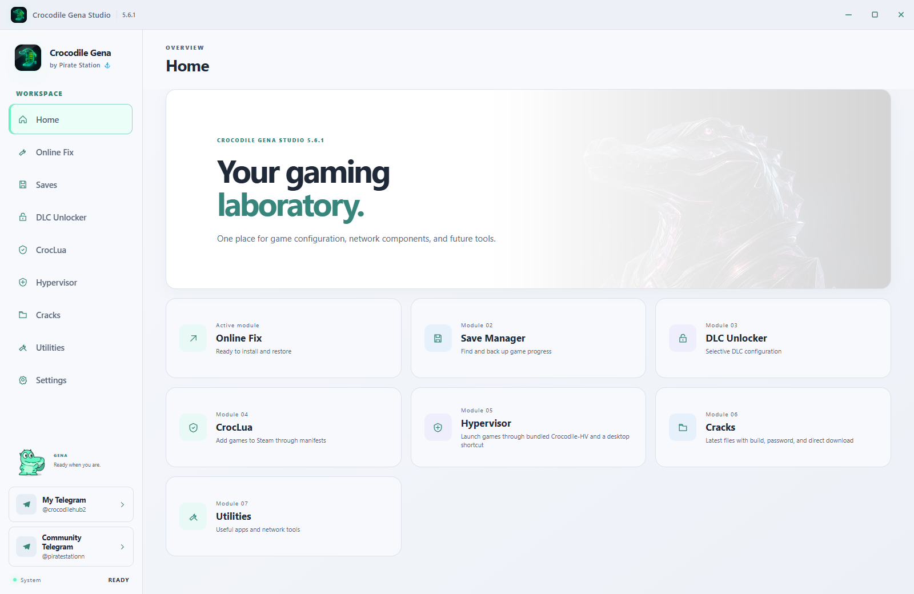

# Crocodile Gena Studio

### Your gaming laboratory.

Seven workspaces for Steam tools, save backups, game components and launch management. 
Built for Windows. Powered by Rust and Tauri.

  
  
  
  

**[Download](https://github.com/LeoBanned/crocodile-gena-studio-releases/releases/latest)** &nbsp;·&nbsp;
**[Build from source](BUILD.md)** &nbsp;·&nbsp;
**[Report an issue](https://github.com/LeoBanned/crocodile-gena-studio-releases/issues)** &nbsp;·&nbsp;
**[Telegram](https://t.me/crocodilehub2)**

The current English interface · Graphite theme · Mint accent

 

## A workspace for the whole process

Scan a game folder, configure its components, back up progress and prepare its launcher from one desktop application. Each module has its own workspace, while shared settings, themes and operation logs keep the experience consistent.

| Discover | Configure | Keep track |
| :--- | :--- | :--- |
| Scan game directories, Steam libraries and common save locations. | Manage supported fixes, DLC configurations, manifests and launch options. | Follow operations in the log and use the backup or restore features provided by each module. |

**Jump to:** [Modules](#seven-modules-one-workspace) · [Screenshots](#a-closer-look) · [What's new](#new-in-561) · [Get started](#get-started) · [Source](#source-and-licensing)

## Seven modules. One workspace.

| Module | What you can do |
| :--- | :--- |
| **01 · Online Fix** | Scan a game directory, identify executables and Steam API libraries, and configure supported Steam or Epic Online Services fixes. |
| **02 · Save Manager** | Find saves across common Windows and Steam locations, create backups and restore them to their recorded paths. |
| **03 · DLC Unlocker** | Discover installed Steam games, browse DLC entries and manage separate CreamAPI or SmokeAPI configurations. |
| **04 · CrocLua** | Import Lua scripts and depot manifests, use Ryuu or HubCap, manage loader DLLs and install the Millennium plugin. |
| **05 · Hypervisor** | Organize Crocodile-HV launches and shortcuts, configure experimental Steam Play integration, scan supported anti-cheat components and inspect VBS status. |
| **06 · Cracks & Downloads** | Browse the community catalog, download archives and extract selected contents into a game directory with backups of replaced files. |
| **07 · Utilities** | Access companion tools and their guides from a dedicated toolbox. |

<strong>Explore the modules in more detail</strong>

### 01 · Universal Online Fix

Drop a game folder into the workspace or select it through the file picker. The scanner looks for executables, architecture and relevant Steam API libraries.

- Game identification and AppID lookup.
- Configuration for supported Steam and EOS fixes.
- DLC entries in supported fix configurations.
- Original-file backups and an operation log.

Compatibility depends on the game and the selected components.

### 02 · Save Manager

Find progress stored outside the game directory: Saved Games, Documents, AppData, Steam userdata and supported emulator save locations.

- Filter common cache, temporary and log files.
- Review discovered folders, file counts and storage usage.
- Create ZIP backups; RAR creation is available with WinRAR installed.
- Restore supported backups using their recorded original locations.

### 03 · DLC Unlocker

Scan Steam libraries or choose a game folder manually, then review the available DLC information.

- Individual selection or the supported unlock-all option.
- Separate CreamAPI and SmokeAPI installation workflows.
- Architecture detection for the selected executable.
- Backup and installation tracking for the relevant method.

Available content and compatibility depend on the game, its files and any server-side requirements.

### 04 · CrocLua & Crocodile Manifest

Manage Lua scripts, depot manifests and their loader components in one place.

- Search supported manifest services: **Ryuu** and **HubCap**.
- Import local **Lua**, **manifest** and **ZIP** files.
- Place files into the relevant Steam folders.
- Check for DLL updates through GitHub.
- Choose and pin the **standard** or **compatibility** bundle.
- Install **Crocodile Manifest 0.5.3** for Millennium.
- Enable **Local Cloud** for Lua games with manifest references and choose your
  own storage folder. The embedded CloudRedirect engine runs with Steam and
  stores the redirected save data locally. A switch restores the previous cloud
  configuration without deleting saves; ordinary games without Lua are not
  redirected. Steam restarts automatically when applying the setting.

Local Cloud uses internal Steam interfaces; compatibility depends on the game
and Steam build. Keep a separate backup before testing it with existing progress.

The plugin adds a **Get manifest** button to supported Steam Store game pages and uses the loader selection shared with CrocLua. Provider access, API keys and quotas depend on the service.

### 05 · Hypervisor, Anti-cheats & VBS

Add a game executable to deploy the bundled **Crocodile-HV** launcher and create a desktop shortcut with the game's name and icon.

The **experimental Steam Play integration** supports account selection, automatic Steam shutdown, launch-option changes and reopening the client. Previous launch options are saved for restoration. This mode forwards Steam's original game command; it may differ from the executable selected for a desktop shortcut.

Other tools in this workspace include:

- A scanner for known components of **12 supported anti-cheat systems**.
- Status display for **VBS**, **Memory Integrity / HVCI** and **Credential Guard**.
- DSE and test-signing information.
- Separate **Fix WMI**, **DISM RestoreHealth** and **SFC Scannow** actions.

Some actions change Windows security or boot settings and may require administrator access or a restart.

### 06 · Cracks, Downloads & Archive Installation

Browse the community catalog and review the available build information, archive size and password details.

- Integrated download progress and speed reporting.
- Supported download cancellation and resume handling.
- ZIP and RAR extraction into a selected game directory.
- Selection of the relevant folder inside an archive.
- Backups of replaced files in the game's backup directory.

Downloaded archive contents are not automatically executed after extraction.

### 07 · Utilities

A hub for companion software and related guides. External tools remain separate projects with their own requirements, behavior and licenses.

## A closer look

**CrocLua — manifests, loader management and the Millennium plugin**

 

**Game launch cards — artwork, executable path and shortcut readiness**

 

<table width="100%">
<tr>
<th width="50%">Make it yours</th>
<th width="50%">Prefer a lighter workspace?</th>
</tr>
<tr>
<td></td>
<td></td>
</tr>
<tr>
<td>Themes, accents, sidebar layout and language.</td>
<td>The same workspace in the White theme.</td>
</tr>
</table>

Previews are captured from the current 5.6.3 interface in English. Example paths, profiles and game entries are demonstration data. Click the gallery images to view them at full size.

## Make the interface yours

**11 themes** · **4 accent colors** · **90–125% scaling** · **Russian & English**

Choose Graphite, Glass, Minimal, Neon, Midnight, Obsidian, Forest, Plum, Warm, Arctic or White. Adjust typography, corner shapes, effects and sidebar layout. Reorder modules or hide the ones you do not use.

And yes, **Gena** can keep you company in the sidebar.

## New in 5.6.3

- **In-app updates on Windows:** download a verified release EXE, replace the
  current executable in place, and restart automatically. Existing shortcuts
  keep their targets. Failed startup triggers a rollback to the previous EXE.
  The notification window shows progress, speed and estimated time remaining.
  Cancel before replacement or postpone automatic reminders for five app
  launches; the sixth launch reminds you again. Manual checks remain available.
- **Local Cloud for manifest games:** choose a local save folder and enable or
  disable the embedded CloudRedirect engine directly in CrocLua.
- **Automatic Steam restart:** launch-option setup and restoration now handle Steam shutdown and reopening.
- **Steam account selection:** active-account detection with a manual selector for multiple saved profiles.
- **Three visible VBS components:** VBS, HVCI and Credential Guard, with their reported states.
- **Updated bundled loader DLLs:** the main application and Crocodile Manifest use the refreshed standard bundle.
- **More consistent themes:** corrected surfaces and colors across the Hypervisor workspace and related panels.

## Get started

### Download a release

1. Open the **[Releases page](https://github.com/LeoBanned/crocodile-gena-studio-releases/releases/latest)**.
2. Download the available package for **Windows x64**.
3. If using a portable ZIP, extract the entire package and keep its accompanying folders together.
4. Launch the application and choose a module from the sidebar.

The interface language, theme and layout can be changed in **Settings**.

### Build from source

The application uses **Rust**, **Tauri 2** and an **HTML/CSS/JavaScript** frontend. Windows builds require Node.js, the Rust MSVC toolchain, Microsoft C++ Build Tools and the Windows SDK.

From the repository root:

~~~powershell
npm ci
npm run doctor
npm run build:portable
~~~

The executable is written to:

~~~text
src-tauri/target/release/crocodile-gena-studio.exe
~~~

**[Read the complete Windows build instructions →](BUILD.md)**

## A few useful details

<strong>What does “Automatic game updates” in CrocLua do?</strong>

During import, the enabled option comments out explicit `setManifestid` pins in Lua files. This removes those version pins so Steam can use available manifests according to its own behavior and settings.

Changing the switch does not rewrite Lua files already installed. To apply it to an existing entry, import or retrieve the appropriate package again. Turning the option off preserves the pins present in the source file; it does not recreate missing pins.

<strong>Is every feature available offline?</strong>

Local workflows use files on your PC. Catalogs, manifest services, Steam Store lookups, downloads and update checks need network access.

<strong>Does every game work with every module?</strong>

No. Support depends on the game, its architecture, installed components and service availability. The Steam Play integration is experimental. Review the operation log when diagnosing an issue.

## Source and licensing

The application's own code is licensed under **GPL-3.0-only**.

Bundled DLLs, executables and external tools retain their respective licenses. The source release for Crocodile Gena Studio does not make every bundled third-party component open source. Personal service credentials are excluded from the public export.

## Feedback & community

Found a bug? Open an **[issue](https://github.com/LeoBanned/crocodile-gena-studio-releases/issues)** with your application version, Windows version, affected module, reproduction steps and relevant log output.

**[Project updates & developer contact](https://t.me/crocodilehub2)** &nbsp;·&nbsp; **[Pirate Station community](https://t.me/piratestationn)**

---

   
  <strong>Crocodile Gena Studio</strong> 
  One workspace for your games, tools and progress.

