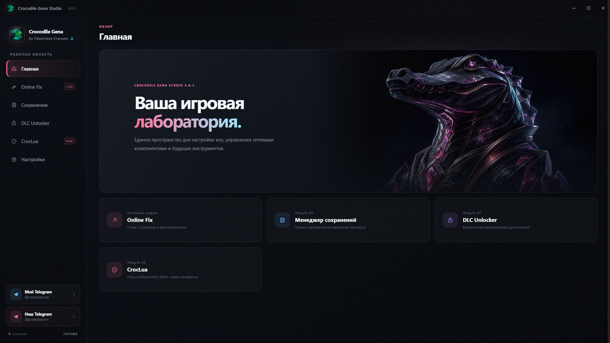

  

<h1 align="center">Crocodile Gena Studio</h1>

  Модульная игровая утилита для Windows в едином аккуратном интерфейсе.

  
  
  
  

  <a href="README_EN.md">English</a> ·
  <a href="https://github.com/LeoBanned/crocodile-gena-studio-releases/releases/latest">Скачать</a> ·
  <a href="https://t.me/crocodilehub2">Telegram</a> ·
  <a href="SUPPORT.md">Поддержка</a>

## О программе

Crocodile Gena Studio объединяет игровые инструменты в одном настольном приложении. Вместо разрозненных папок, скриптов и окон пользователь получает единый интерфейс, понятные статусы операций и автоматическую проверку обновлений.

### Возможности

- **Online Fix** — установка, проверка и восстановление игровых компонентов с понятным пошаговым процессом.
- **Менеджер сохранений** — поиск сохранений и создание резервных копий игрового прогресса.
- **DLC Unlocker** — управление совместимыми игровыми компонентами из одного интерфейса.
- **CrocLua** — работа с библиотекой Steam и пользовательскими ключами сервисов манифестов.
- **Статусы и история** — наглядный результат каждой операции без необходимости следить за консолью.
- **Автообновление** — проверка новой версии при каждом запуске приложения.

## Скачать

Актуальная версия доступна только на странице официальных релизов:

### [Скачать Crocodile Gena Studio](https://github.com/LeoBanned/crocodile-gena-studio-releases/releases/latest)

Не скачивайте приложение из случайных перезаливов. Установочные файлы не хранятся в ветке репозитория: они публикуются отдельно в разделе **Releases**.

## Установка

1. Откройте [последний релиз](https://github.com/LeoBanned/crocodile-gena-studio-releases/releases/latest).
2. Скачайте установщик Crocodile Gena Studio.
3. Закройте Steam и другие программы, с которыми собираетесь работать.
4. Запустите установщик и следуйте подсказкам.
5. При необходимости разрешите запуск в Windows SmartScreen только после проверки, что файл получен из официального репозитория.

Подробности и решение типичных проблем находятся в [инструкции по установке](docs/INSTALLATION_RU.md).

## Системные требования

- Windows 10 или Windows 11, 64-bit;
- подключение к интернету для поиска компонентов, обращения к выбранным сервисам и проверки обновлений;
- установленные Steam или другие поддерживаемые игровые клиенты — только для функций, которым они требуются;
- права администратора для операций, изменяющих файлы установленных приложений.

## API-ключи и данные

Некоторые функции требуют личный API-ключ стороннего сервиса. Ключ вводится самим пользователем, хранится локально на его компьютере и используется для запросов к выбранному сервису. Никогда не публикуйте API-ключи в Issues, скриншотах или логах.

Подробнее: [политика конфиденциальности](PRIVACY.md).

## Поддержка

Нашли ошибку — создайте [Bug report](../../issues/new?template=bug_report.yml). Идею можно отправить через [Feature request](../../issues/new?template=feature_request.yml).

Для связи с автором: [@crocodilehub2](https://t.me/crocodilehub2).

## Важное замечание

Crocodile Gena Studio предназначена для работы с программами и играми, которыми пользователь вправе пользоваться. Пользователь самостоятельно отвечает за соблюдение лицензий сторонних продуктов и правил используемых сервисов. Проект не связан с Valve Corporation, Steam или другими упомянутыми правообладателями.

## Репозиторий и лицензия

Этот публичный репозиторий является официальной страницей продукта и каналом распространения релизов. Он не предоставляет права на копирование, модификацию или повторное распространение приложения и его оригинальных материалов. Подробные условия приведены в [LICENSE.md](LICENSE.md).

© 2026 Crocodile Gena Software.
