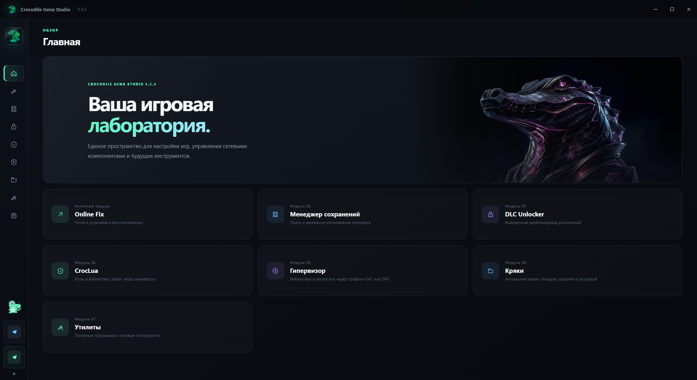

<div align="center">

**Русский | [English](README.en.md)**

# 🐊 CrocodileGena Studio

### **Ультимативный центр управления библиотекой Steam, дополнениями, сетевыми фиксами и системной средой**

[](https://github.com/)
[-0078D6?style=for-the-badge&logo=windows&logoColor=white)](https://microsoft.com/windows)
[](https://tauri.app/)
[](#-система-безопасности-и-отката)
[](#-конфиденциальность)

<p align="center">
  <b>Умное сканирование игр</b> • <b>Разблокировка DLC в 1 клик</b> • <b>Universal Online Fix</b> • <b>Резерв прогресса</b> • <b>CrocLua & Манифесты</b> • <b>Античиты & Защита</b>
</p>

[✨ О программе](#-о-программе) • [🧩 Модули](#-полный-обзор-всех-модулей) • [🛡️ Безопасность](#-система-безопасности-и-отката) • [⚙️ Настройки](#-настройки-и-персонализация) • [🚀 Установка и сборка](#-установка-и-сборка) • [❓ FAQ](#-часто-задаваемые-вопросы-faq)

---

</div>

## 🖼️ Интерфейс



<p align="center"><sub>Главная страница версии 5.5.5. Стиль, акцент, боковую панель и масштаб можно настроить под себя.</sub></p>

---

## 📖 О программе

**CrocodileGena Studio (Desktop Edition)** — это мощное настольное приложение нового поколения, созданное для полной автоматизации работы с играми Steam и сетевыми компонентами. 

Программа объединяет в себе инструменты сканирования файлов, инжекции сетевых эмуляторов, менеджера сохранений, автоматического добавления игр через Lua-манифесты, управления низкоуровневой защитой Windows (VBS/HVCI) и аудита античит-драйверов.

Приложение полностью написано на современном стеке **Rust (Tauri v2) + нативный Dark Glassmorphism UI**. Вся работа с файлами, реестром Windows, PE-заголовками и сетью выполняется напрямую из скомпилированного кода без использования промежуточных Python-серверов или консольных утилит.

---

## 🧩 Полный обзор всех модулей

Приложение разделено на **7 функциональных рабочих пространств**, доступных через боковую панель навигации:

| № | Модуль | Иконка | Назначение |
| :---: | :--- | :---: | :--- |
| **01** | **Universal Online Fix** | 🛠️ | Сетевой эмулятор Steam, Spacewar лобби, фиксы Epic Online Services (EOS) |
| **02** | **Менеджер сохранений** | 💾 | Глубокий поиск игрового прогресса (15+ путей), бэкап в ZIP/RAR, откат |
| **03** | **DLC Unlocker** | 🔑 | Выборочная разблокировка дополнений через **SmokeAPI** или **CreamAPI** |
| **04** | **CrocLua & Манифесты** | 📜 | Добавление игр в клиент Steam, поиск через Ryuu/HubCap, плагин Millennium |
| **05** | **Системная безопасность** | 🛡️ | Запуск конфигураций, чистка 12 античитов, управление VBS/DSE/Test Mode |
| **06** | **Кряки (Crack Vault)** | 📦 | Облачный каталог релизов с 6-поточным встроенным загрузчиком |
| **07** | **Утилиты** | 🧰 | Набор внешних инструментов (CirnoDownloader, Sigma, Zapret2) и гайды |

---

### 🛠️ Модуль 01: Universal Online Fix

Единый рабочий процесс для адаптации одиночных и кооперативных игр под сетевую игру через сервера Steam и Epic Games.

#### Ключевые возможности:
* **Умный анализ директории игры**:
  * Поддерживается перетаскивание папки (Drag & Drop) или системный проводник.
  * Автоматический обход структуры: обнаружение исполняемого файла игры (`.exe`), архитектуры (`x86` / `x64`), наличия библиотек `steam_api.dll` / `steam_api64.dll`.
  * Детекция игрового движка (Unreal Engine 4/5, Unity, CryEngine и др.).
* **Интеллектуальная идентификация**:
  * Автоматическое извлечение или ручной поиск AppID через официальный Steam Store API с подгрузкой обложек высокого разрешения.
* **Гибкая конфигурация сетевого лобби (Fake AppID)**:
  * `480` — Spacewar *(наиболее популярный)*;
  * `1484020` — Cube Racer;
  * `250820` — SteamVR;
  * `3989960` — Custom AppID.
* **Встроенный анлокер DLC**:
  * Автоматический сбор официального списка дополнений из базы Steam Store;
  * Добавление секции `[DLC]` прямо в конфигурационные файлы фикса (`OnlineFix.ini` / `OnlineFix64.ini`).
* **Модуль Epic Online Services (EOS)**:
  * Проверка наличия и состояния библиотеки `EOSSDK-Win64-Shipping.dll`.
  * Установка адаптированного EpicFix для устранения проблем с созданием сетевых комнат.
  * Кнопка мгновенного восстановления оригинального EOSSDK.
* **Интерактивный терминал операций (Live Log)**:
  * Пошаговый вывод каждого действия (создание бэкапа, замена библиотек, запись ini).

---

### 💾 Модуль 02: Менеджер сохранений (Save Manager)

Автоматизированный центр резервного копирования и синхронизации игрового прогресса. Решает проблему потери сохранений при переустановке Windows, смене репака или установке фиксов.

#### Поддерживаемые расположения (15+ категорий):
1. **Системные каталоги Windows**:
   * `%USERPROFILE%\Saved Games` (Сохраненные игры)
   * `%USERPROFILE%\Documents\My Games` и корневые папки в Документах
   * `%LOCALAPPDATA%` (включая структуры движка Unreal Engine: `*\Saved\SaveGames`)
   * `%APPDATA%` (Roaming)
   * `%LOCALAPPDATA%Low` (структуры движка Unity: `LocalLow\<Company>\<Game>`)
2. **Официальный клиент Steam**:
   * `<Steam>\userdata\<AccountID>\<AppID>`
3. **Эмуляторы Steam и популярные релиз-группы**:
   * `Goldberg SteamEmu Saves` / `GSE Saves`
   * `SmartSteamEmu` / `SteamEmu`
   * `CODEX` / `EMPRESS` / `RUNE` / `FLT` / `TENOKE` / `SKIDROW`
   * `OnlineFix` / `0xdeadc0de`

#### Особенности и функционал:
* **Умный фильтр мусора**: сканер автоматически игнорирует временные файлы кэша (`cache`, `gpucache`, `shadercache`, `crashpad`, `logs`, `.tmp`, `.dmp`, `lockfile`).
* **Детальная статистика**: точный подсчет количества папок, обнаруженных файлов и суммарного дискового объема в реальном времени.
* **Создание архивов**:
  * Встроенная упаковка в формат **ZIP** (без внешних зависимостей).
  * Поддержка создания сжатых **RAR**-архивов при наличии установленного WinRAR.
  * В каждый архив встраивается манифест `cgs-save-manifest.json` со слепком точных оригинальных путей.
* **Безопасное восстановление прогресса**:
  * Распаковка архива обратно по оригинальным системным папкам с защитой от выхода за пределы путей (Anti-Path Traversal) и контролем размера.

---

### 🔑 Модуль 03: DLC Unlocker

Полнофункциональный менеджер дополнений, позволяющий получить доступ ко всему каталогу DLC установленной игры без ручного редактирования конфигов.

```
                  ┌───────────────────────────────┐
                  │    Автосканирование Steam     │
                  │   (libraryfolders.vdf + ACF)  │
                  └───────────────┬───────────────┘
                                  │
                  ┌───────────────▼───────────────┐
                  │    Сводный Каталог DLC        │
                  │  Steam Store API + AppInfo.vdf│
                  └───────┬───────────────┬───────┘
                          │               │
     ┌────────────────────▼────┐     ┌────▼────────────────────────┐
     │   Способ 1: CreamAPI    │     │     Способ 2: SmokeAPI      │
     ├─────────────────────────┤     ├─────────────────────────────┤
     │ • Подмена steam_api.dll │     │ • PE-прокси рядом с EXE     │
     │ • Бэкап steam_api_o.dll │     │ • version / winhttp / winmm │
     │ • Опция ExtraProtection │     │ • Библиотеки Steam НЕ тронуты│
     └─────────────────────────┘     └─────────────────────────────┘
```

#### Ключевые возможности:
* **Глубокая интеграция с библиотеками Steam**:
  * Сканирование всех библиотек на всех дисках через парсинг `libraryfolders.vdf` и манифестов `appmanifest_*.acf`.
  * Автоматический отсев незавершенных загрузок, системных инструментов и утилит.
  * Возможность добавить кастомную папку библиотеки или выбрать папку игры вручную.
* **Сводный каталог дополнений**:
  * Синхронизация данных из официального Steam Store API и локального бинарного кэша клиента `appcache/appinfo.vdf` (поддерживаются форматы v27, v28, v29).
  * Отображение скрытых, удаленных из магазина и регионально заблокированных DLC.
  * Живой поиск по названию или ID дополнения.
  * Переключатель «Разблокировать все» либо ручной выбор галочками конкретных дополнений.
* **Два независимых метода установки**:
  * **SmokeAPI (4.1.3)**:
    * Проксирование системных библиотек рядом с EXE игры (`version.dll`, `winhttp.dll` или `winmm.dll`).
    * **Файлы Steam не изменяются!**
    * Автоматический PE-анализ архитектуры целевого бинарника (`x64` / `x86`) с выбором соответствующей сборки.
    * Ведение транзакционного реестра `.cgs-smaki.json` для чистого удаления.
  * **CreamAPI**:
    * Классическая интеграция с заменой `steam_api.dll` / `steam_api64.dll`.
    * Автоматическое создание бэкапа оригиналов `steam_api_o.dll` / `steam_api64_o.dll`.
    * Опция **Extra Protection** — обход внутренних механизмов игры по проверке цифровой подписи и контрольной суммы Steam API.

---

### 📜 Модуль 04: CrocLua & Манифесты

Инструмент прямого добавления лицензионных игр в официальный клиент Steam через скрипты Lua и Depot-манифесты.

#### Ключевые возможности:
* **Автоопределение клиента Steam**:
  * Автоматическое чтение путей установки через реестр Windows (`HKCU\Software\Valve\Steam`).
  * Кнопка быстрой перезагрузки клиента Steam в один клик для применения добавленных игр.
* **Интеграция с сервисами манифестов**:
  * **Ryuu Generator** (`generator.ryuu.lol`):
    * Прямой поиск в базе и загрузка манифестов.
    * Встроенный обход Cloudflare с эмуляцией реального Chrome User-Agent.
  * **HubCap** (`hubcapmanifest.com`):
    * Поддержка пользовательского API-ключа.
    * Отслеживание суточных квот и оставшихся загрузок прямо в интерфейсе (счетчик 0/25).
* **Автоматическая раскладка файлов**:
  * Программа автоматически размещает `.lua` в `config/lua/`, а `.manifest` файлы — в корневой `depotcache/`.
* **Ручной импорт**:
  * Поддержка перетаскивания (Drag & Drop) любых файлов `.lua`, `.manifest` или архивов `.zip`.
* **Менеджер добавленных игр**:
  * Просмотр списка активных игр, возможность временного отключения или полного удаления.
  * Детальная карточка игры: дата релиза, обложка, сравнение списка разблокированных дополнений с отсутствующими в lua.
  * Опция **Автообновления манифестов**.
* **Плагин Millennium («Crocodile Manifest»)**:
  * Встроенный модуль для фреймворка Millennium (v0.5.0), использующий тот же комплект DLL и папку `config/lua/`, что и CrocLua.
  * Установка в один клик: добавляет стильную кнопку **«Получить манифест»** прямо на страницы игр внутри официального магазина Steam!

---

### 🛡️ Модуль 05: Системная безопасность, Античиты и VBS

Инженерный модуль для аудита системной среды Windows, работы со службами защиты и безопасного запуска игровых конфигураций.

#### 1. Менеджер запуска конфигураций:
* Каталогизация игр и назначение специализированных профилей запуска (KVC / DRV).
* Автоматическая проверка прав администратора (UAC) и готовности окружения перед стартом.
* Интерактивный журнал событий с детальным протоколированием каждого шага.

#### 2. Сканер античитов (Anti-Cheat Auditor):
Глубокое сканирование и удаление остаточных компонентов **12 популярных античит-систем**:
1. **Easy Anti-Cheat (EAC)** — Epic Games (`EasyAntiCheat`, `EasyAntiCheat_EOS`);
2. **BattlEye** — BattlEye Innovations (`BEService`);
3. **Riot Vanguard** — Riot Games (`vgk.sys`, `vgc`);
4. **FACEIT Anti-Cheat** — FACEIT AC;
5. **EA AntiCheat** — Electronic Arts (`EAAntiCheat`);
6. **PunkBuster** — Even Balance (`PnkBstrA`, `PnkBstrB`);
7. **XIGNCODE3** — Wellbia (`xhunter1.sys`);
8. **nProtect GameGuard** — INCA Internet (`npggsvc`);
9. **Anti-Cheat Expert (ACE)** — Tencent (`ace-base.sys`, `ace-game.sys`);
10. **TrueProtect / MoMo** — NetEase;
11. **Denuvo Anti-Cheat** — Irdeto (`DenuvoAntiCheat`);
12. **EQU8 Anti-Cheat** — EQU8.

> [!NOTE]
> Перед любой операцией очистки античита программа создает локальную резервную копию удаляемых служб и путей.

#### 3. VBS & Безопасность Windows:
* Инспекция статуса **Virtualization-based Security (VBS)** и **Hypervisor-protected Code Integrity (HVCI)**.
* Проверка параметров Device Guard, Credential Guard, System Guard, HyperGuard в реестре `HKLM`.
* Мониторинг статуса **Driver Signature Enforcement (DSE)**.
* Управление **Тестовым режимом Windows (Testsigning mode)** через конфигурацию BCD:
  * Включение тестового режима для запуска неподписанных библиотек;
  * Напоминание об отключении Secure Boot в BIOS/UEFI.
* Функция безопасного отключения визора («Выключить визор») с сохранением всех предыдущих значений реестра и параметров загрузки в `cgs-vbs-snapshot.json` для мгновенного отката («Включить визор»).

---

### 📦 Модуль 06: Каталог кряков (Crack Vault)

Встроенный клиент для загрузки проверенных фиксов и кряков от сообщества Пиратской Станции.

* **Прямая синхронизация**: автоматическая подгрузка каталога из облачного репозитория.
* **Закрепленные файлы**: быстрый доступ к популярным библиотекам и универсальным эмуляторам.
* **Детальная информация**: номер билда игры, пароли к архивам, размер и дата релиза.
* **Высокоскоростной 6-поточный загрузчик (Parallel Multi-Part Engine)**:
  * Скачивание файла в 6 параллельных потоков с расчетом скорости и отображением прогресса.
  * Поддержка возобновления и безопасной отмены загрузки.
  * Кнопка быстрого показа скачанного архива в системном Проводнике Windows.

#### 📂 Распаковка ZIP / RAR прямо в папку игры

После скачивания архива можно нажать **«Распаковать в игру»** — без ручного переноса файлов и без установленного WinRAR для этой операции.

* **Поддержка DenuvOwO и ARTIFACT**: программа находит нужную папку внутри архива. Если подходящих папок несколько, можно выбрать нужную.
* **Содержимое — в корень игры**: копируются файлы из выбранной папки, а не сама внешняя папка. Внутренняя структура сохраняется.
* **Пароль подставляется автоматически** из карточки загрузки и копируется в буфер обмена.
* **Одно окно и одна кнопка «Распаковать»**: выбор папки игры, просмотр содержимого и запуск операции без отдельного окна «Подготовить».
* **Короткий список содержимого**: папки первого уровня показываются по одному разу, без длинного списка всех вложенных путей. JPG/JPEG скрыты только в списке — при распаковке они сохраняются.
* **Резервная копия заменяемых файлов**: оригиналы сохраняются в `.cgs-backups` внутри папки игры. Скачанный архив остаётся в Загрузках.
* Содержимое архива **не запускается автоматически**.

Подробнее о работе распаковщика: **[ARCHIVE-INSTALL.md](ARCHIVE-INSTALL.md)**.

---

### 🧰 Модуль 07: Утилиты (Toolbox)

Интегрированный хаб сопутствующего программного обеспечения для комфортной загрузки и настройки игр:

* **CirnoDownloader** — скоростной загрузчик манифестов и контента Steam.
* **Sigma** — альтернативный загрузчик с графическим интерфейсом.
* **Zapret2** — сетевая утилита для обхода DPI-замедлений и блокировок игровых серверов.
* **Интерактивный гайд**: пошаговое руководство по настройке пресетов Zapret2 (выбор пресетов с ALT) для стабильной работы загрузчиков без разрыва соединения.

---

## 🎨 Настройки и персонализация

В разделе **Настройки** доступны параметры для тонкой адаптации приложения под ваши предпочтения:

* 🌈 **Цветовой световой акцент**:
  * 🟢 **Mint** (Неоновый мятный — по умолчанию)
  * 🟣 **Violet** (Глубокий кибер-фиолетовый)
  * 🔵 **Blue** (Классический неоновый синий)
  * 🔴 **Rose** (Яркий неоновый розовый)
* 🌐 **Мультиязычность**: моментальное переключение интерфейса между **Русским** и **English** без перезапуска.
* 🔑 **Выбор сервиса CrocLua**: переключение источника манифестов (Ryuu с ключом, заданным при сборке или HubCap с вводом своего ключа и мониторингом лимита).
* 🔄 **Центр обновлений**:
  * Проверка новых версий приложения через официальный репозиторий GitHub.
  * Прямая загрузка обновленного **Portable EXE** или установщика **Setup (NSIS)**.
* 📢 **Официальные каналы связи**: быстрый доступ к сообществу Пиратской Станции и личной поддержке разработчика в Telegram.

### ✨ Готовые стили интерфейса

**11 вариантов оформления**, включая светлый стиль:

| Стиль | Характер |
| :--- | :--- |
| **Graphite** | Базовый тёмный интерфейс |
| **Glass** | Стеклянное оформление |
| **Minimal** | Сдержанный минимализм |
| **Neon** | Неоновые акценты |
| **Полночь** | Тёмно-синяя палитра |
| **Обсидиан** | Глубокие тёмные оттенки |
| **Лес** | Зелёная палитра |
| **Слива** | Фиолетовые оттенки |
| **Тёплый** | Тёплая палитра |
| **Север** | Холодные оттенки |
| **Белый** | Светлый интерфейс |

### 🧩 Настройте рабочее пространство под себя

* **Боковая панель** — полная, компактная или только с иконками. Порядок модулей можно менять.
* **Видимость модулей** — ненужные разделы можно скрыть из меню и с Главной, а затем вернуть в настройках.
* **Масштаб 90–125%** и три формы элементов: строгая, мягкая и округлая.
* **Пять вариантов типографики**: системный шрифт, Bahnschrift, Verdana, Tahoma и Consolas. Дополнительно настраиваются насыщенность шрифта и повышенный контраст.
* **Анимации и свечения** — включаются и выключаются отдельно.
* **Живой талисман Гена** — реагирует на действия; может находиться в боковой панели или в плавающем блоке. Его и реакции можно отключить.

Настройки сохраняются локально и применяются без перезапуска программы.

---

## 🛡️ Система безопасности и отката

Безопасность пользовательских данных — главный приоритет CrocodileGena Studio. Программа придерживается строгих стандартов защиты:

```
[Пользователь] ──► [Действие] ──► [Побайтовый бэкап] ──► [Манифест хэшей] ──► [Применение фикса]
                                                                                   │
[Восстановление] ◄── [Удаление фикса] ◄── [Проверка хэшей] ◄── [Откат оригинала] ◄─┘
```

1. **Побайтовый бэкап (`.backup_orig`)**: перед заменой любой оригинальной библиотеки Steam (`steam_api.dll`, `steam_api64.dll`, `EOSSDK-Win64-Shipping.dll`) создается точная копия файла и JSON-манифест с контрольными суммами.
2. **Чистое удаление**: при нажатии кнопки «Удалить / восстановить» созданные файлы фиксов удаляются, а оригиналы возвращаются на свои места.
3. **Изоляция реестра**: любые правки параметров VBS и Device Guard сохраняются в локальный снимок `cgs-vbs-snapshot.json`.
4. **SmokeAPI Safe Mode**: прокси-файлы `version.dll` / `winhttp.dll` / `winmm.dll` удаляются строго при совпадении с хэшами анлокера, чужие системные библиотеки никогда не перезаписываются и не повреждаются.
5. **Безопасность сохранений**: при резервировании и распаковке архивов сохранений используется строгая валидация путей для предотвращения Path Traversal.

---

## 🚀 Установка и сборка

### Готовые релизы
Скачайте готовый билд из раздела **Releases**:
* `CrocodileGenaStudio-Setup.exe` — установщик для Windows;
* `CrocodileGenaStudio-Portable.exe` — портативная версия без установки.

---

### Сборка из исходного кода

Подробная пошаговая инструкция по сборке, настройке окружения и решению возможных ошибок описана в файле:
👉 **[BUILD.md](BUILD.md)**

```powershell
# Быстрый старт:
npm ci
npm run doctor
npm run dev

# Сборка релизного инсталлятора:
npm run build:setup
```

---

## ❓ Часто задаваемые вопросы (FAQ)

<details>
<summary><b>Что выбрать для разблокировки DLC: SmokeAPI или CreamAPI?</b></summary>
<br>

* **SmokeAPI (рекомендуется по умолчанию)**: устанавливается рядом с игровым EXE (`version.dll`, `winhttp.dll` или `winmm.dll`). Оригинальные файлы Steam не модифицируются. Если игра обновляется, анлокер часто продолжает работать без повторной установки.
* **CreamAPI**: заменяет `steam_api.dll` или `steam_api64.dll`. Подходит для более старых игр или игр, где защитные механизмы блокируют загрузку внешних прокси-DLL рядом с EXE.
</details>

<details>
<summary><b>Почему игра не запускается после установки Online Fix?</b></summary>
<br>

1. Убедитесь, что в фоновом режиме запущен официальный клиент **Steam**.
2. Если игра использует сетевой стек Epic Games, перейдите в блок **Epic Online Services** в Модуле 01 и нажмите **«Установить EpicFix»**.
3. Проверьте антивирус (Windows Defender): он может ошибочно поместить эмулятор в карантин. Добавьте папку с игрой в исключения.
</details>

<details>
<summary><b>Как работает тестовый режим (Testsigning) и VBS?</b></summary>
<br>

Некоторые специализированные драйверы требуют отключения проверки подписей (DSE) или изоляции ядра (HVCI/VBS). CrocodileGena Studio позволяет выключить эти механизмы в один клик. Для активации тестового режима необходимо предварительно отключить **Secure Boot** в настройках UEFI/BIOS материнской платы.
</details>

<details>
<summary><b>Куда сохраняются бэкапы при откате?</b></summary>
<br>

В папке с игрой создается директория `.backup_orig`. В ней хранится оригинальный файл и манифест хэшей. При откате программа проверяет контрольную сумму и гарантирует восстановление файла в исходное состояние, после чего папка `.backup_orig` безопасно удаляется.
</details>

---

## Лицензия исходного кода

Собственный код автора доступен по **GPL-3.0-only** — [LICENSE](LICENSE).
Для самостоятельной сборки начните с [BUILD.md](BUILD.md); есть помощник `BUILD-WINDOWS.cmd`.

## ⚖️ Дисклеймер

Данное программное обеспечение создано исключительно в образовательных, исследовательских и ознакомительных целях для изучения архитектуры приложений Windows, реверс-инжиниринга динамических библиотек и механизмов виртуализации. Разработчики не несут ответственности за неправомерное использование данного ПО или нарушение лицензионных соглашений сторонних сервисов.

---

<div align="center">

**CrocodileGena Studio** • *Разработано с заботой о пользователях* • 2026

[](https://t.me/crocodilehub2)

</div>
